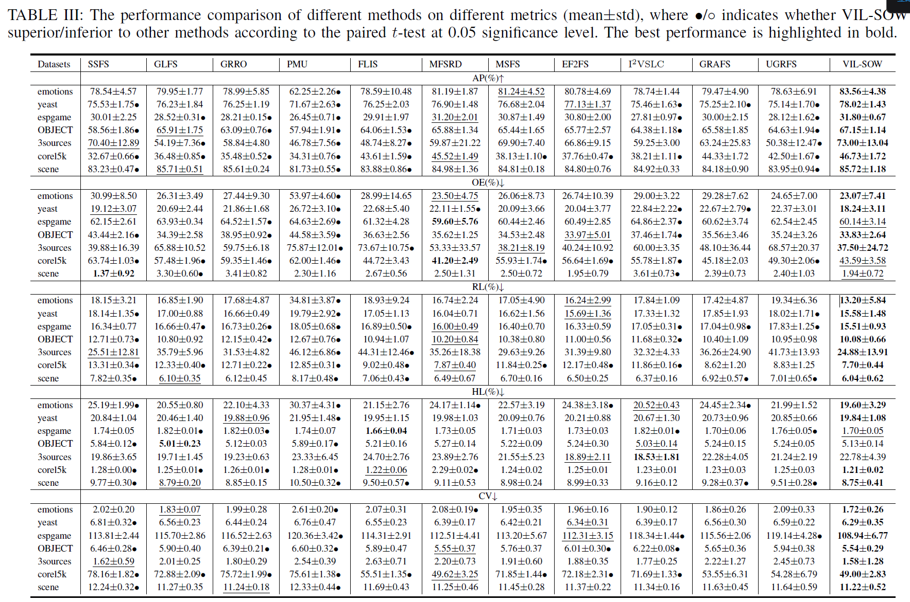

# VILSOW: Code for Multi-view Multi-label Feature Selection By View-specific Implicit Label Information and Second-order Weight Matrix

This repository contains the implementation of **VILSOW** and a demo using the `emotions` dataset.

**Paper:** Multi-view Multi-label Feature Selection By View-specific Implicit Label Information and Second-order Weight Matrix

**DOI:** https://doi.org/10.1109/TMM.2026.3701532

## Requirements
- MATLAB (R2018a or later recommended)
- Dataset: `emotions.mat` (included in `./datasets`)

## Quick Start
1. Clone the repository.
2. Open MATLAB and navigate to the folder.
3. Run `demo.m`.

## Results

The script will output the evaluation metrics (Average Precision, Hamming Loss, etc.) in the command window and save the convergence plot to `./results`.

## Corrections

This section provides corrections and clarifications to the experimental results reported in Table III and the metric labels in Figs. 6 and 7 of the published paper.

### Table III: Performance Comparison

Several numerical entries in Table III have been corrected. In addition, the reporting precision of the Ranking Loss (RL) and Hamming Loss (HL) results has been standardized to two decimal places.

The corrected Table III is presented below.

The following numerical entries have been corrected for the **scene** dataset:

| Metric | Method | Original | Corrected |
|---|---|---|---|
| AP (%) | GRRO | 85.61 ± 0.61 | 85.61 ± 0.24 |
| OE (%) | GRRO | 3.41 ± 3.41 | 3.41 ± 0.82 |
| RL (%) | GRRO | 6.10 ± 0.60 | 6.12 ± 0.45 |
| HL (%) | GRRO | 8.80 ± 0.85 | 8.85 ± 0.15 |
| CV | GRRO | 11.24 ± 0.34 | 11.24 ± 0.18 |
| OE (%) | SSFS | 1.37 ± 3.61 | 1.37 ± 0.92 |

The remaining adjustments to the RL and HL values reflect the use of consistent numerical precision based on the original experimental results.

### Figures 6 and 7: Metric Labels

The metric labels **OE** and **CV** were inadvertently interchanged in Figs. 6 and 7. The corresponding labels have been corrected.

These corrections do not affect the proposed method, the experimental setup, or the overall conclusions of the paper.
